[English](README.md) · **Español**
# WAF Flight Recorder

[](https://github.com/albeen-sknight/waf-flight-recorder/actions/workflows/lab.yml)

**Demo en vivo:** https://albeen-sknight.github.io/waf-flight-recorder/

Puse un firewall de aplicaciones web de verdad delante de una tienda que está rota a propósito. Luego la ataqué, escribí mis propias reglas, las rompí, encontré un fallo en el conjunto de reglas oficial y lo arreglé sin abrir un agujero. Cada afirmación de aquí abajo tiene detrás una entrada de log y un test que falla en cuanto deja de ser verdad.

Este README es dos cosas a la vez. Es la historia de un proyecto que construí. Y es un manual: si no has tocado un WAF en tu vida, puedes leerlo de arriba abajo y aprender lo que aprendí yo, en el orden en que lo aprendí. Cada idea nueva lleva primero un ejemplo cotidiano y luego el nombre técnico. Cada comando lleva un comentario que dice lo que hace de verdad.

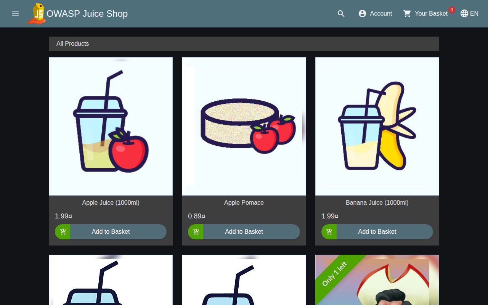

*La Juice Shop de verdad, corriendo detrás de mi WAF.*

## Contenido

1. [Qué es este proyecto](#qué-es-este-proyecto)
2. [Sobre mí](#sobre-mí)
3. [Por qué lo monté](#por-qué-lo-monté)
4. [Cómo lo aprendí](#cómo-lo-aprendí)
5. [Cuánto tiempo me llevó](#cuánto-tiempo-me-llevó)
6. [Para qué sirve](#para-qué-sirve)
7. [Qué construí, en palabras sencillas](#qué-construí-en-palabras-sencillas)
8. [Cómo lo construí, fase a fase](#cómo-lo-construí-fase-a-fase)
9. [Lo que aprendí](#lo-que-aprendí)
10. [Pruébalo tú mismo](#pruébalo-tú-mismo)
11. [Glosario](#glosario)
12. [Estructura del repositorio, seguridad y qué viene después](#estructura-del-repositorio)

## Qué es este proyecto

Imagina una tienda construida llena de agujeros a propósito, para que la gente pueda practicar a entrar a robar sin hacerle daño a nadie. Esa tienda existe. Se llama [OWASP Juice Shop](https://owasp.org/www-project-juice-shop/), vende zumos y se usa en todo el mundo para formación en seguridad.

Ahora imagina a un guardia de seguridad en la puerta de la tienda. A cada visitante lo revisan antes de que llegue al mostrador. Ese guardia es un **WAF**, un firewall de aplicaciones web.

En este proyecto yo soy la persona que entrena a ese guardia. Le di un manual profesional, escribí instrucciones extra mías, mandé ladrones de mentira a la puerta para ver a quién pillaba, encontré un caso en el que el guardia paraba a un cliente honrado y lo arreglé sin volver a dejar entrar a los ladrones. Y lo apunté todo, con pruebas.

Es un laboratorio de aprendizaje. No protege nada real, y cada ataque va a una copia de la tienda corriendo en mi propio ordenador.

## Sobre mí

Aquí en GitHub me llaman Albeen. Tengo 19 años, vivo en Madrid y estoy en segundo de ASIR (administración de sistemas informáticos en red).

Me mudé a España desde mi país de origen con 13 años, sin un español ni un inglés en condiciones. El bachillerato no era una opción para mí, así que tiré por la FP: SMR, una estancia Erasmus fuera, y luego ASIR. Ese "plan B" acabó siendo el camino que me abrió la carrera.

En mayo de 2026 hice el programa Technology Trainee de Deloitte en la rama de CyberSOC. Durante el verano trabajé como técnico de soporte a pie de obra, instalando equipos Cisco y Meraki y dando soporte a usuarios por Madrid y Sevilla. En mi tiempo libre monto labs de SIEM con Elastic y Kibana: dashboards de inicios de sesión fallidos, investigaciones con el Visor de eventos de Windows, lo básico de respuesta a incidentes.

Mi plan es sencillo. Primero el SOC. Primero unas buenas bases. Seguridad de aplicaciones y WAF más adelante.

## Por qué lo monté

Durante el programa de Deloitte conocí a un Senior WAF Engineer que había empezado haciendo ASIR, igual que yo. Eso hizo que el camino fuera real. También me enseñó un hueco: todo lo que había tocado de verdad era SIEM y análisis de logs. El WAF era algo de lo que hablaba, no algo que hubiera hecho.

Así que quería una prueba que poder poner encima de la mesa. No "el WAF es hacia donde va mi carrera". Sino: "aquí hay un WAF que desplegué, ataqué y ajusté, y sé explicar cada decisión que tomó".

Mi primera idea fue escribir mi propio WAF desde cero. La descarté. Eso es como aprender a ser árbitro construyendo un estadio: semanas de obra, y todavía no has arbitrado ni un partido. Un ingeniero de WAF trabaja con un motor maduro y un manual de reglas maduro. El trabajo de verdad es leer reglas, perseguir falsas alarmas y ajustar sin debilitar la protección. Así que eso es lo que hice.

## Cómo lo aprendí

Todavía estoy aprendiendo, así que lo monté como aprende mucha gente hoy en día: con Claude Code, un asistente de programación con IA, de tutor. Me montó el laboratorio alrededor (los contenedores, el ejecutor de tests, el pipeline de GitHub) y redactó las primeras reglas y la primera documentación. Usé todo eso para aprender el trabajo. Hice correr el laboratorio en mi propio portátil, escribí mis propias reglas, las rompí a propósito y descubrí un falso positivo que nadie había planeado.

Piénsalo como un profesor de autoescuela con dobles mandos. El profesor sacó el coche a la carretera; el que está aprendiendo a conducir soy yo. Las reglas 100080 y 100090 son mis primeras vueltas en solitario, y [el tutorial](docs/tutorial-first-rule.md) enseña cada paso.

## Cuánto tiempo me llevó

Unas dos semanas desde la idea hasta el repo terminado, pero la mayor parte fue planificar y pensar. La construcción a mano entró en un solo día largo.

| Cuándo | Qué pasó |
| --- | --- |
| 21 sep 2026 | Tuve la idea y escribí el primer plan. Cambié "construir mi propio WAF" por "hacer funcionar uno de verdad". |
| 22 al 30 sep | Planifiqué la construcción en los huecos entre las clases y el trabajo: las herramientas, las fases y lo que quería demostrar. |
| 1 oct, mañana | El laboratorio se puso en marcha: el WAF, la tienda, las primeras reglas, los tests y el pipeline de GitHub. |
| 1 oct, tarde | Lo hice correr en mi propio portátil por primera vez. 62 tests en verde. |
| 1 oct, noche | Escribí mis dos primeras reglas, las rompí, las arreglé y subí mi primer commit. 70 tests en verde. |
| 3 al 7 oct | Dejé fina la documentación y las capturas. |

Si estás pensando en construir algo así: poner el laboratorio en marcha es rápido. Entender por qué salta cada regla es lo que lleva tiempo, y esa parte sigue en marcha.

## Para qué sirve

Por cada visitante que llega a la puerta, quiero poder responder a cinco preguntas:

1. ¿Qué miró el guardia?
2. ¿Qué instrucción se activó?
3. ¿Por qué se activó?
4. ¿Qué decidió el guardia?
5. Si la decisión fue mala, ¿cómo lo arreglo sin dejar al guardia inútil?

## Qué construí, en palabras sencillas

### Cómo funciona una conversación con una web

Usar una web es como pedir en el mostrador de un restaurante. Entregas una comanda (una **petición**) y te devuelven algo (una **respuesta**).

| Parte de la comanda | Versión del restaurante | Versión de la web | Ejemplo de este laboratorio |
| --- | --- | --- | --- |
| **Método** | Lo que quieres hacer | `GET` = enséñame algo, `POST` = aquí va algo nuevo, `PUT` = cambia esto, `DELETE` = quita esto | `GET /rest/products/search` |
| **Ruta** | En qué mostrador estás | La página o el servicio con el que hablas | `/rest/user/login` |
| **Parámetros** | Los detalles de tu pedido | Info extra en la dirección después de `?` | `?q=apple` significa "busca manzana" |
| **Cabeceras** | El carné que enseñas | Info sobre quién pregunta: nombre del navegador, cookies, de dónde vienes | `User-Agent: Mozilla/5.0 ...` |
| **Cuerpo** | Un formulario rellenado | Los datos que mandas, como un formulario de login | `{"email": "...", "password": "..."}` |

Y la respuesta vuelve con un **código de estado**, un número de tres cifras que dice cómo ha ido:

| Código | Versión del restaurante | Significado |
| --- | --- | --- |
| `200` | "Aquí tienes tu comida" | Todo bien |
| `201` | "Pedido recibido" | Se ha creado algo nuevo |
| `401` | "Enséñame primero tu carné de socio" | Hay que iniciar sesión |
| `403` | "Tú no entras" | Rechazado. En este laboratorio normalmente significa que mi WAF te paró |
| `404` | "Ese plato no lo tenemos" | Esa página no existe |

### Qué es un WAF

Un WAF se pone entre los visitantes y la web. Es un guardia que además hace de recepcionista: cada visitante habla con el recepcionista, nunca directamente con la gente de la trastienda. El recepcionista los revisa, y solo entonces los acompaña. El nombre técnico de ese trabajo de recepcionista es **proxy inverso**.

El guardia que usé tiene tres capas:

| Capa | Versión cotidiana | Lo que es de verdad |
| --- | --- | --- |
| **ModSecurity 2.9.7** | El guardia: ojos, manos, una libreta | El motor. Lee cada petición y sigue las instrucciones que le den |
| **OWASP CRS v4.29.0** | Un manual de reglas gordo escrito por expertos | Cientos de reglas ya hechas para ataques comunes, mantenidas por OWASP |
| **Mis propias reglas** | Mis pósits añadidos al manual | Reglas pequeñas que escribí, probé y ajusté yo mismo |

El guardia trabaja en la puerta de un servidor web **Apache 2.4**, y la tienda que hay detrás de la puerta es **OWASP Juice Shop v20.2.0**, la imagen oficial, sin tocar.

### El montaje

```
 navegador / ejecutor de tests ──▶ 127.0.0.1:8080 ──▶ WAF: Apache 2.4.58 + ModSecurity 2.9.7 + OWASP CRS v4.29.0
                                                           │ solo las peticiones permitidas
                                                           ▼
                                           OWASP Juice Shop v20.2.0 (red interna, sin puerto publicado)

 WAF ──▶ evidence/raw/audit.json   una línea por petición: la "caja negra"
```

Todo corre en **Docker**. Un contenedor de Docker es como una fiambrera: una app empaquetada con todo lo que necesita, para que funcione igual en cualquier ordenador. Tengo dos fiambreras (el WAF y la tienda) y una lista de empaquetado que dice cómo se conectan (`compose.yaml`).

| Pieza | Lo que usé | Por qué |
| --- | --- | --- |
| La tienda | [OWASP Juice Shop](https://owasp.org/www-project-juice-shop/) v20.2.0 | Insegura a propósito, mantenida por OWASP, llena de páginas realistas y agujeros de verdad |
| El guardia | ModSecurity 2.9.7 sobre Apache 2.4.58 | El motor de referencia para CRS |
| El manual | OWASP CRS v4.29.0, fijado, nunca editado | El conjunto de reglas profesional que quería aprender |
| Mi capa | Mis propias reglas, 2 excepciones, ajustes de CRS | En archivos separados, para que cada cambio salga en git |
| La prueba | 45+ escenarios de test, pytest, GitHub Actions | Cada afirmación es un test |
| Los muros | Redes de Docker, solo localhost | La tienda nunca toca internet |

Más detalle: [arquitectura](docs/architecture.md).

## Cómo lo construí, fase a fase

### Fase 0: la puerta, el pasillo y la tienda

**En palabras sencillas:** antes de entrenar al guardia, construí el edificio. Una puerta a la calle, un pasillo solo para personal detrás de ella, y la tienda al final del pasillo. Los visitantes solo pueden llegar a la tienda pasando por la puerta.

- Construí mi propio contenedor del WAF a partir de Ubuntu con Apache y ModSecurity, y me descargué CRS en una versión fija. Construirlo yo mismo significaba que conocía cada archivo que llevaba dentro.
- Juice Shop está en una **red interna** sin puerta a la calle. Ese es el pasillo solo para personal.
- El WAF escucha en `127.0.0.1:8080`. `127.0.0.1` significa "solo este ordenador", así que ni siquiera alguien en mi WiFi de casa puede llegar a él.

```powershell
docker compose up -d --build   # construye los contenedores y arranca el laboratorio en segundo plano (-d = detached)
docker compose ps              # lista los contenedores en marcha; la línea del WAF debería decir "healthy"
```

En mi portátil (Windows, Docker Desktop), los dos contenedores arriba y el WAF healthy. Fíjate en que Juice Shop muestra `3000/tcp` sin dirección: solo se puede llegar a ella dentro de Docker. El WAF muestra `127.0.0.1:8080`:

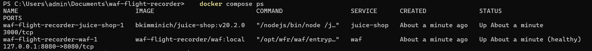

*Los dos contenedores arriba en mi portátil, y el WAF healthy.*

Lo primero que salió mal: ModSecurity se negaba a arrancar porque algunos ajustes no están permitidos dentro de la config de una sola web, solo a nivel de servidor. Así que toda la config de ModSecurity se carga desde un archivo, [`modsecurity/main.conf`](modsecurity/main.conf), que además fija el orden en que se carga todo. Ese archivo es lo primero que le diría a cualquiera que leyera.

### Fase 1: la caja negra

**En palabras sencillas:** los aviones llevan una caja negra que lo graba todo, para que después de un incidente puedas reproducir exactamente lo que pasó. Le puse una a mi guardia. Cada petición recibe una línea en `evidence/raw/audit.json`: lo que entró, qué reglas reaccionaron, qué decidió el guardia.

Cada petición recibe también un **ID de transacción**, como el número de seguimiento de un paquete. Mi WAF se lo devuelve al visitante en una cabecera llamada `X-WFR-Transaction`, así que puedo coger cualquier respuesta y encontrar su línea exacta en el log.

```powershell
curl.exe -i "http://localhost:8080/rest/products/search?q=%27%20OR%201%3D1--"
# curl.exe manda una petición desde la línea de comandos, como un navegador sin ventana.
# -i muestra también las cabeceras de la respuesta, para ver el código de estado y el ID de transacción.
# %27 es como se escribe un carácter ' en una dirección web, %20 es un espacio, %3D es =.
```

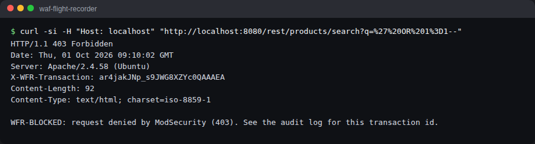

*Mi WAF rechazando el ataque con un 403, y el número de seguimiento en la cabecera X-WFR-Transaction.*

Luego aprendí los dos modos en los que puede trabajar un guardia:

- **DetectionOnly** es como un circuito de cámaras sin nadie mirando en directo: se graba todo, pero no se para a nadie. Perfecto para una prueba de rodaje.
- **On** significa que el guardia para a la gente de verdad.

Mandé el mismo ataque en los dos modos:

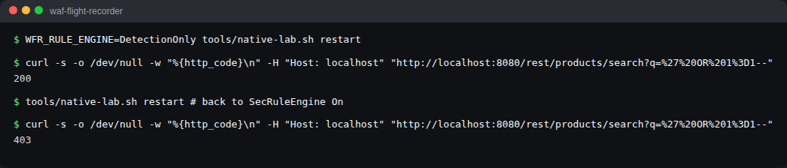

*El mismo ataque dos veces: 200 cuando el guardia solo mira, 403 cuando está en On.*

Mismas reglas, misma puntuación. `200` (pasó) en DetectionOnly, `403` (rechazado) cuando está activo. Redacté una entrada de log real, parte por parte: [cómo leo una transacción](docs/how-to-read-a-transaction.md).

### Fase 2: escribir mis propias reglas

#### Cómo funciona una regla

Este es el modelo mental que hizo que todo lo demás me encajara.

Piensa en el WAF como un **portero en la puerta de una discoteca**. Cada petición es una persona que intenta entrar. Una **regla** es una instrucción en la tarjeta del portero: "Mira **el nombre del carné**. Si **contiene "Albeen-Scanner"**, compruébalo **en la puerta**, y **no le dejes entrar**".

En el idioma de ModSecurity:

```
SecRule REQUEST_HEADERS:User-Agent "@contains Albeen-Scanner" "id:100080,phase:1,deny,status:403,log,t:none,msg:'My rule'"
```

| Pieza | Versión del portero | Qué significa |
| --- | --- | --- |
| `SecRule` | "Aquí va una instrucción" | Toda regla empieza por esto |
| `REQUEST_HEADERS:User-Agent` | **Dónde** mirar: el carné | La cabecera donde cada navegador o herramienta dice su nombre |
| `@contains Albeen-Scanner` | **Qué** buscar | Coincide si ese texto aparece en cualquier parte |
| `id:100080` | El número de la instrucción | Único. Los míos van del 100000 al 100999 |
| `phase:1` | **Cuándo**: en la puerta | En cuanto llegan las cabeceras, antes de leer el cuerpo |
| `deny,status:403` | **Qué hacer**: no dejar entrar | Bloquéalo y responde con un 403 |
| `t:none` | ¿Limpiar primero la entrada? No | Mira "transformaciones" más abajo |
| `log,msg:'...'` | Apúntalo en la libreta | Déjalo en el registro de auditoría con este mensaje |

Cada regla, la mía o la de CRS, responde a las mismas cinco preguntas: dónde miro, qué busco, cuándo, ¿limpio primero la entrada? y qué hago al respecto.

#### Cuándo: las cinco fases

ModSecurity revisa una petición por etapas, como el control de un aeropuerto:

| Fase | Versión del aeropuerto | Qué hay disponible |
| --- | --- | --- |
| 1 | Control de pasaporte en la entrada | La dirección, el método, las cabeceras |
| 2 | El escáner de maletas | También el cuerpo: formularios, logins, JSON |
| 3 | Mirar lo que sale del edificio (cabeceras) | Las cabeceras de la respuesta |
| 4 | Mirar lo que sale del edificio (contenido) | El cuerpo de la respuesta |
| 5 | Rellenar la libreta al final del turno | Todo, para el log |

Una regla en la fase equivocada puede estar perfectamente escrita y aun así ser inútil, porque lo que busca todavía no ha llegado. Lo demostré en la Fase 5.

#### Qué buscar: operadores

| Operador | Versión cotidiana | Ejemplo |
| --- | --- | --- |
| `@contains` | "¿El nombre lleva esta palabra en algún sitio?" | `@contains Albeen-Scanner` |
| `@streq` | "¿Es exactamente esto, nada más?" | `@streq DELETE` |
| `@beginsWith` | "¿Empieza por esto?" | `@beginsWith /ftp` |
| `@rx` | "¿Encaja con este patrón?" (una expresión regular: un patrón de búsqueda, como "cualquier palabra seguida de TABLE") | `@rx \bdrop\s+table\b` |
| `@gt` | "¿Es este número mayor que...?" | `@gt 100` |

#### Limpiar primero la entrada: transformaciones

Imagina a un portero cuya lista dice "prohibido entrar a JOHN". Llega alguien con un carné que pone "john". Letras distintas, misma persona. Un portero listo lee todos los nombres en mayúsculas antes de mirar la lista. Eso es una **transformación**: ordenar la entrada antes de compararla.

| Transformación | Qué hace | Ejemplo |
| --- | --- | --- |
| `t:none` | Nada. Compruébalo tal cual llegó | `John` sigue siendo `John` |
| `t:lowercase` | Todo a minúsculas | `JoHn` pasa a `john` |
| `t:urlDecodeUni` | Descodifica el encoding de direcciones web | `%66tp` pasa a `ftp` |
| `t:normalizePath` | Limpia rutas enrevesadas | `/./ftp` pasa a `/ftp` |
| `t:length` | Cambia el texto por su longitud | `apple` pasa a `5` |

Esta la aprendí por las malas, con mi propia regla.

#### Mis primeras reglas, en mi portátil

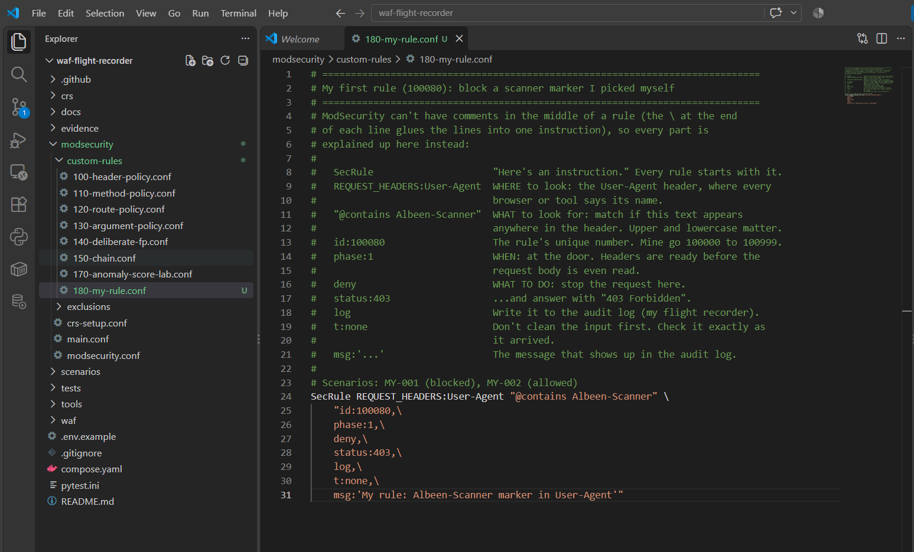

*Mi primera regla, la 100080, en VS Code. Cada parte está explicada en los comentarios de encima.*

Me hago pasar por mi propio escáner. `-A` pone el User-Agent, así que es básicamente un carné falso:

```powershell
curl.exe -i -A "Albeen-Scanner/1.0" http://localhost:8080/
# curl.exe manda una petición desde la línea de comandos, como un navegador sin ventana.
# -i muestra también las cabeceras de la respuesta. -A pone el User-Agent: el nombre del carné.
```

`403 Forbidden` y **WFR-BLOCKED**.

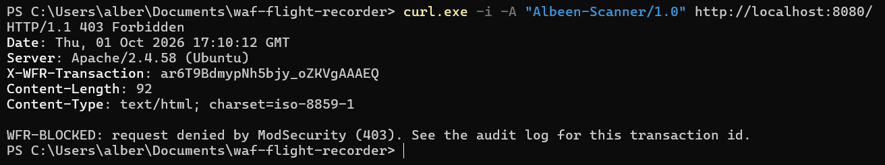

*Mi escáner falso rechazado en la puerta.*

El mismo nombre de escáner, en minúsculas:

```powershell
curl.exe -s -o NUL -w "%{http_code}\n" -A "albeen-scanner/1.0" http://localhost:8080/
# El mismo carné falso, pero escrito en minúsculas
# -s = silencioso, -o NUL = tira la página, -w = imprime solo el código de estado
```

`200`. Entró directo. A `@contains` le importan las mayúsculas y las minúsculas, y `t:none` significa que nada ordena la entrada primero. Un atacante solo tiene que cambiar una letra.

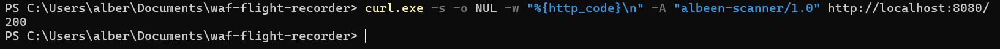

*Una letra en minúscula, y mi regla lo dejó entrar directo.*

Dos cambios pequeños: `t:none,` pasa a `t:none,t:lowercase,`, y `@contains Albeen-Scanner` pasa a `@contains albeen-scanner`. Ahora los dos dan 403.

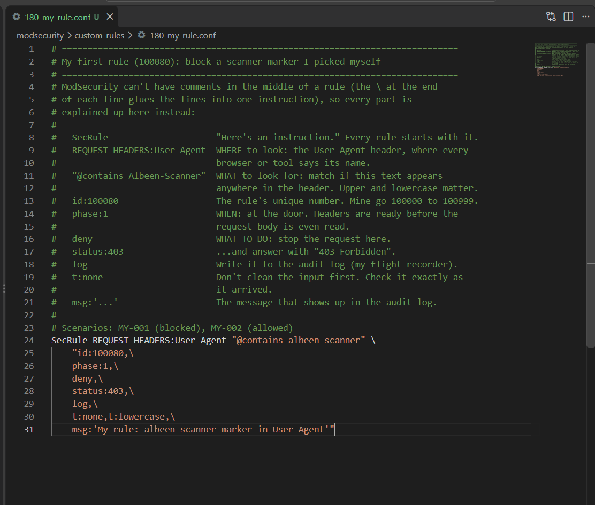

*El arreglo: t:lowercase ordena el nombre antes de comprobarlo.*

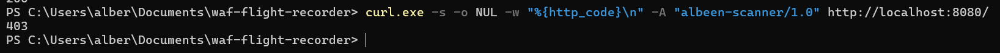

*El truco de la minúscula ahora bloqueado.*

Mi primera regla miraba una sola cosa. Las reglas de verdad muchas veces necesitan que dos cosas sean ciertas a la vez, así que para mi segunda regla quise aprender una **cadena**.

La idea, en términos de calle: un cliente en el mostrador pide "zumo de manzana". Alguien que entrega una comanda de 300 palabras no está comprando. Está probando qué hace la cocina con una entrada rara. Las herramientas de ataque hacen justo eso: meten textos largos y raros en las cajas de búsqueda a ver qué se rompe. Así que la regla **100090** bloquea las búsquedas de productos de más de 100 caracteres, y solo en la página de búsqueda.

```powershell
$long = "a" * 120
# Crea un texto de 120 letras "a". PowerShell puede multiplicar texto así.
curl.exe -s -o NUL -w "%{http_code}\n" "http://localhost:8080/rest/products/search?q=apple"
# Una búsqueda normal: se espera 200
curl.exe -s -o NUL -w "%{http_code}\n" "http://localhost:8080/rest/products/search?q=$long"
# Una búsqueda de 120 letras: se espera 403
curl.exe -s -o NUL -w "%{http_code}\n" "http://localhost:8080/api/Products?q=$long"
# El mismo texto largo en otra página: se espera que NO sea 403, porque la cadena solo cubre la página de búsqueda
```

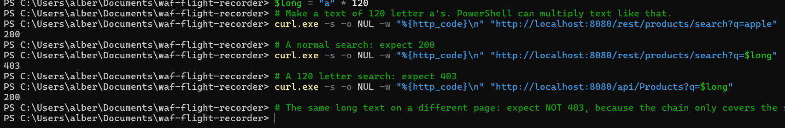

*Una búsqueda normal da 200, la de 120 letras da 403, y el mismo texto largo en otra página da 200.*

Luego la rompí a propósito. Le quité `t:length` a la segunda condición. La búsqueda de 120 letras ahora da un **200**. Sin `t:length`, el guardia compara el texto "aaaa..." con el número 100. Eso no tiene sentido, así que no coincide nunca, y la regla, sin decir nada, no hace nada. Ni error, ni aviso. Solo un guardia que dejó de trabajar.

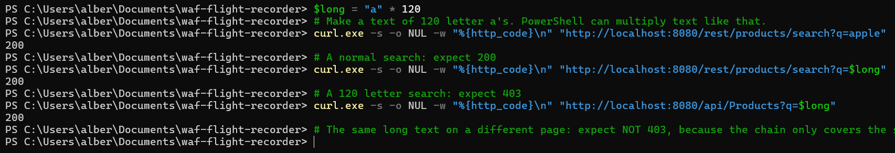

*Sin t:length, mi regla dejó de funcionar sin hacer ruido.*

`t:length` de vuelta, `docker compose restart waf`, y la búsqueda larga vuelve a ser un **403**.

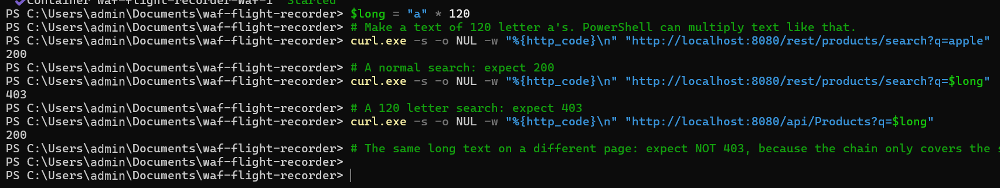

*t:length de vuelta, y la búsqueda larga vuelve a estar bloqueada.*

La lección que saqué de esta: una regla rota no siempre peta. A veces simplemente deja de coincidir sin hacer ruido. Cada paso, incluidos los reinicios y el registro de auditoría, está en [mis primeras reglas, paso a paso](docs/tutorial-first-rule.md).

#### Las reglas que escribí

Cada una enseña una decisión:

| Regla | Qué hace | La lección |
| --- | --- | --- |
| 100001 | Bloquea el marcador de laboratorio `WFR-Lab-Bot` en el User-Agent | Fase 1, una cabecera, y a `@contains` le importan mayúsculas y minúsculas |
| 100010 | Rechaza los métodos WebDAV (comandos de compartición de archivos que Juice Shop no usa nunca) con un 405 | `@within` comprueba "¿está escondido en algún sitio dentro?", así que habría bloqueado `PATCH` por estar dentro de `PROPPATCH`. Usé un patrón exacto en su lugar |
| 100020 / 100040 | Bloquea la carpeta `/ftp` expuesta de Juice Shop, escrita dos veces: con y sin transformaciones | `/FTP/` se pasea por delante de la versión sin `t:lowercase` |
| 100030 | Bloquea un campo con nombre | Los formularios de login llegan como JSON, y los campos salen como `ARGS:email`, no como `json.email` como supuse al principio |
| 100050 | Una regla que hice demasiado amplia a propósito, y luego arreglé | Bloqueaba a alguien buscando "cough drops" (pastillas para la tos). Mis propias reglas necesitan el mismo cuidado que las de cualquiera |
| 100060 | Dos condiciones juntas: `DELETE` *y* la página de feedback | Cada condición por separado está bien. Solo la combinación es sospechosa. Eso es una **cadena** |
| 100070 / 100071 | Suma puntos de penalización, una vez en fase 2, otra en fase 1 | La versión de fase 1 no hace nada de nada (mira la Fase 5) |
| 100080 | Mi propio marcador de escáner, en cualquier combinación de mayúsculas | Mi primera regla escrita desde cero en mi portátil: [el tutorial](docs/tutorial-first-rule.md) |
| 100090 | Bloquea las búsquedas de productos de más de 100 caracteres, solo en la página de búsqueda | Una cadena de dos condiciones, y `t:length` para convertir texto en número. Sin ello, la regla no hace nada sin avisar: [el tutorial](docs/tutorial-first-rule.md#my-second-rule-two-conditions-and-a-number-instead-of-text) |

¿Por qué bloquear `/ftp`? Con el guardia en DetectionOnly, esto es lo que Juice Shop le enseña a cualquiera que lo pida:

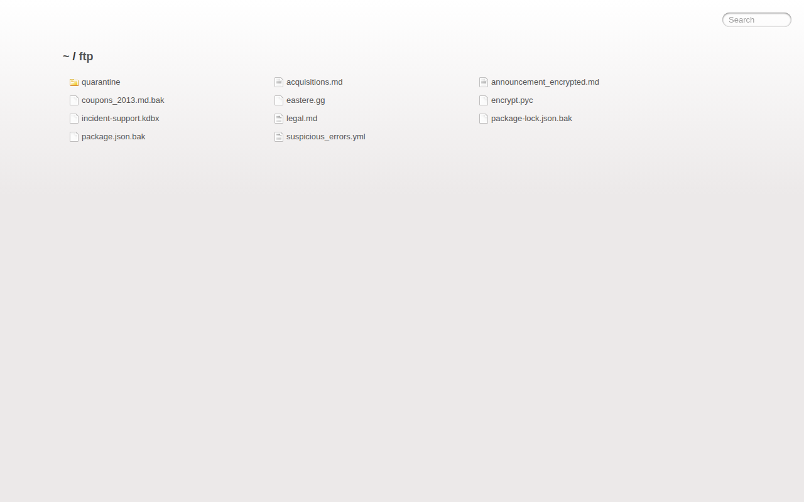

*La carpeta /ftp de Juice Shop, abierta a cualquiera mientras el WAF solo mira.*

Copias de seguridad, una base de datos de contraseñas, un anuncio cifrado. Un archivador dejado abierto en el vestíbulo. Con mi regla activa, la misma dirección da esto:

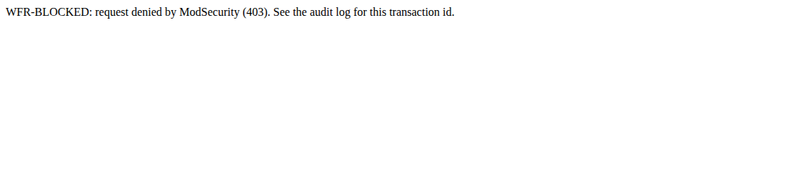

*La misma dirección, bloqueada por mi regla.*

Arreglarlo en el WAF sin tocar la app se llama **parche virtual**: no puedes arreglar el archivador hoy, así que le pones un guardia delante.

Cada regla tiene tests de lo que debe bloquear y de lo que debe dejar pasar:

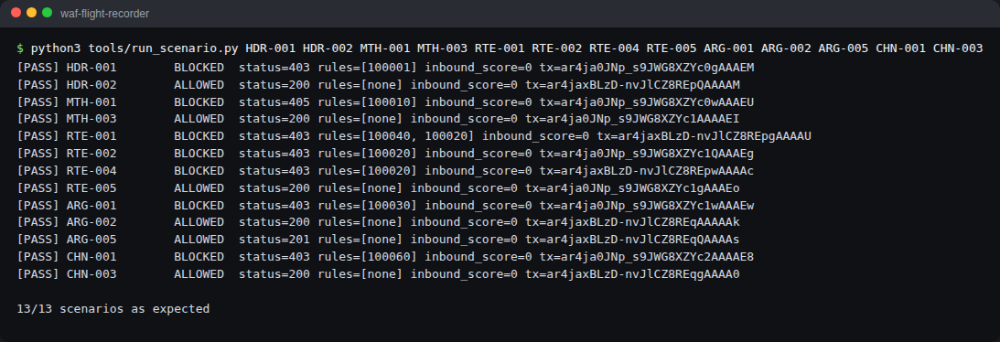

*Cada regla probada por las dos caras: lo que debe bloquear y lo que debe dejar pasar.*

Detalles de cada regla: [notas de ModSecurity](docs/modsecurity-notes.md). Los archivos de reglas explican cada decisión en sus comentarios: [`modsecurity/custom-rules/`](modsecurity/custom-rules/).

### Fase 3: simulacros de incendio que se ejecutan solos

**En palabras sencillas:** un edificio no se fía de sus alarmas de incendios porque funcionaran una vez. Hace simulacros, con regularidad. Hice lo mismo con mis reglas.

Cada petición de test se apunta como un **escenario**: la petición, y lo que el guardia debe hacer con ella. Aquí hay uno de verdad:

```yaml
id: HDR-001                                   # el nombre del escenario
name: lab bot marker in User-Agent is blocked # qué comprueba, en palabras
request: {method: GET, path: /, headers: {User-Agent: "WFR-Lab-Bot/1.0"}}   # la petición a mandar
expected: {decision: blocked, status: 403, intercepted_by: 100001}          # lo que DEBE pasar
```

Mi ejecutor de tests manda cada uno, encuentra su línea exacta en la caja negra por el ID de transacción, y comprueba la decisión, qué regla lo paró, qué reglas reaccionaron y la puntuación. Además se niega a mandar nada a ningún sitio que no sea mi laboratorio.

```powershell
docker compose --profile test run --rm tests
# Arranca el contenedor "tests" (está en un perfil para que no corra por defecto),
# ejecuta cada escenario contra el WAF en vivo, y luego borra el contenedor (--rm).
```

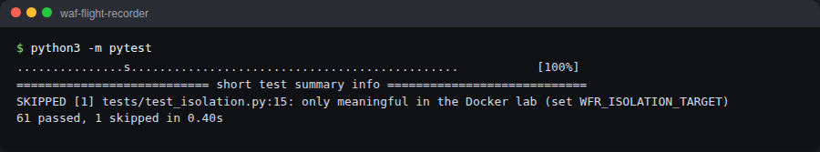

*El conjunto entero de simulacros, ejecutado en el contenedor de tests.*

Y en mi portátil, contra la Juice Shop de verdad en Docker. 62 en verde, incluida la comprobación de que a Juice Shop no se puede llegar de ninguna forma que no sea a través del WAF:

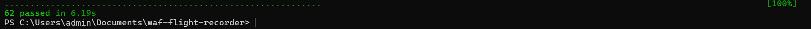

*62 en verde en mi portátil, contra la Juice Shop de verdad.*

Después de añadir mis dos reglas y seis tests míos: 70 en verde.

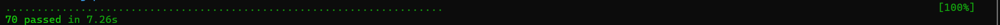

*70 en verde tras añadir mis dos reglas y sus tests.*

Y luego mi primer commit al proyecto:

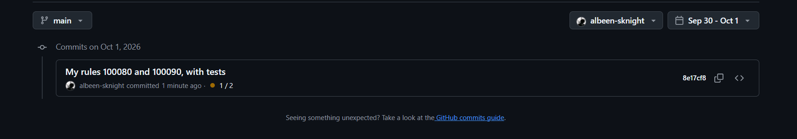

*Mi primer commit: mis dos reglas y sus seis tests.*

Encima de eso, **GitHub Actions** (un robot que corre en los ordenadores de GitHub) reconstruye el laboratorio entero desde cero y vuelve a pasar todos los simulacros cada vez que subo un cambio. Ese es el tic verde de arriba de esta página.

Para ver la caja negra de forma legible, una línea por petición:

```powershell
docker compose --profile test run --rm tests python tools/summarize_audit.py -n 10
# Ejecuta mi script de resumen dentro del contenedor de tests: las últimas 10 peticiones,
# con BLOCK o allow, la fase, la puntuación, el código de estado y los IDs de regla.
```

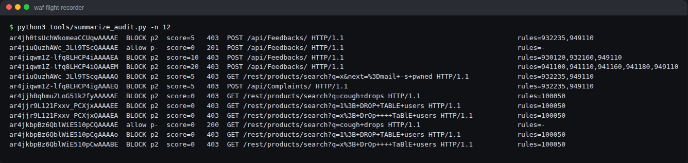

*La caja negra, una línea por petición: BLOCK o allow, la puntuación y las reglas que saltaron.*

### Fase 4: el manual profesional, y los ataques que para

Luego cargué CRS, el manual escrito por los expertos de OWASP, y ataqué la tienda con cadenas de prueba clásicas. Esto es lo que significa cada ataque en palabras sencillas:

| Ataque | Versión cotidiana | Lo que mandé |
| --- | --- | --- |
| **Inyección SQL** | Escribir en una comanda: "un café, y de paso dile al cocinero que abra la caja fuerte". La cocina sigue instrucciones escritas, así que obedece | `' OR 1=1--` como email de login, que le dice a la base de datos "inicia sesión como quien sea, porque 1=1 siempre es verdad" |
| **XSS** (cross site scripting) | Dejar una nota en el libro de visitas que le hace algo a quien la lea después | `<script>alert(1)</script>` en la caja de búsqueda |
| **Path traversal** | Pedirle al recepcionista "la sala dos plantas por encima del archivo" para colarte en el despacho del jefe | `../../../../etc/passwd`, subiendo carpetas para llegar a un archivo del sistema |
| **Inyección de comandos** | Pedir "una pizza; y de paso dame las llaves de la tienda" | `x; cat /etc/passwd`, intentando colar un comando del sistema |
| **Escáner** | Alguien que entra con una chapa de "ladrón" puesta | Un `User-Agent` que dice `sqlmap`, una herramienta de ataque muy conocida |

Convertí cada ataque de esa tabla en un test:

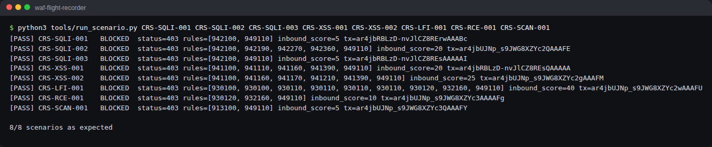

*Cada ataque de la tabla, bloqueado por CRS.*

Todos bloqueados. Una búsqueda normal, claro, pasa directa:

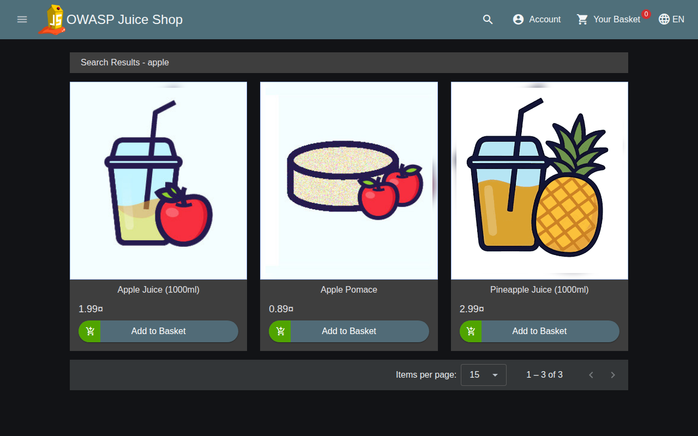

*Una búsqueda normal de apple pasa directa.*

El famoso bypass del login de admin de Juice Shop, `' OR 1=1--` como email, ya no mete a nadie dentro. El guardia lo para antes de que Juice Shop llegue a verlo:

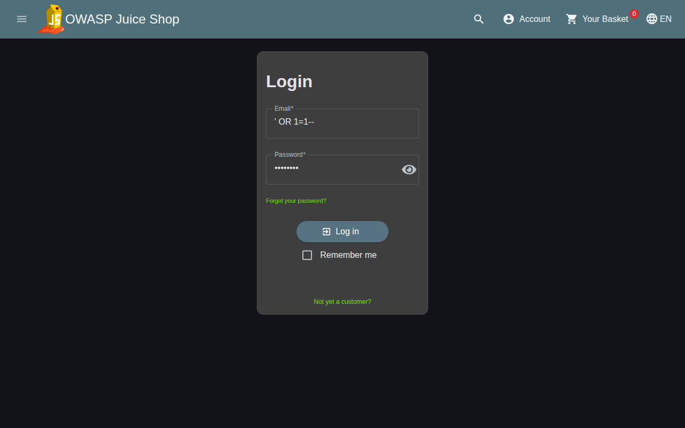

*El WAF bloqueando mi inyección SQL en la página de login.*

Lo mismo desde mi propio navegador, la primera vez que hice correr el laboratorio en mi portátil:

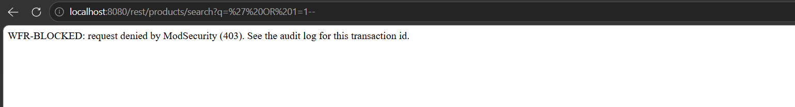

*El mismo ataque bloqueado en mi propio navegador, en mi portátil.*

CRS tiene un mando de rigidez llamado **nivel de paranoia**, del 1 (relajado, pocas falsas alarmas) al 4 (desconfía de todo el mundo). Yo usé el nivel 1.

Ver un 403 no es lo mismo que entenderlo. Así que elegí cinco reglas de CRS y desmonté cada una, como un mecánico abriendo un motor: qué mira, cómo limpia la entrada, con qué coincide, cuántos puntos da, y qué pasa cuando cambio exactamente una cosa de la petición.

| Regla | Lo que encontré |
| --- | --- |
| [942100](docs/crs-rule-autopsies/942100.md) | Lee SQL como un idioma en vez de buscar patrones. `O'Reilly` pasa. `1 OR 1=1` no |
| [941110](docs/crs-rule-autopsies/941110.md) | Seis pasos de limpieza descodifican texto disfrazado antes incluso de hacer la comprobación |
| [930120](docs/crs-rule-autopsies/930120.md) | Solo una lista de nombres de archivos sensibles. Ningún patrón |
| [932235](docs/crs-rule-autopsies/932235.md) | Necesita un símbolo, un comando y un hueco. Un enlace web pegado le aporta dos sin querer |
| [920350](docs/crs-rule-autopsies/920350.md) | Se fija en una IP a secas en vez de un nombre de sitio. Pocos puntos, nunca bloquea por sí sola |

### Fase 5: puntos de penalización

**En palabras sencillas:** CRS funciona como los puntos del carné de conducir. La mayoría de las reglas no te echan. Suman puntos: 5 por algo serio, 3 o 2 por algo raro. Al final, una regla árbitro (949110) cuenta los puntos. Llega al límite (el **umbral**, 5 por defecto) y estás fuera.

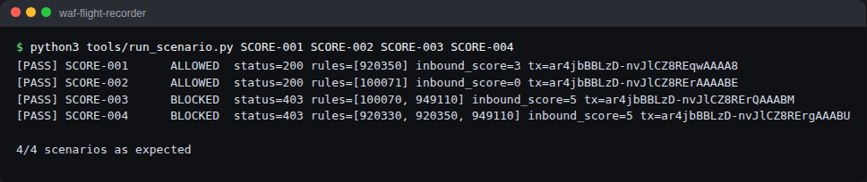

*Los puntos de penalización sumando: una rareza se queda por debajo de 5, dos juntas lo cruzan.*

- Entrar con una IP a secas suma 3 por sí solo. Registrado, permitido.
- Añade un nombre de navegador vacío (2 más) y llega a 5. Bloqueado. Dos rarezas pequeñas suman.
- Mi propia regla de puntos en fase 1 quedó borrada, porque CRS resetea los puntos de todo el mundo a cero justo después. La misma regla en fase 2 bloquea. La misma regla, en otro momento, un resultado completamente distinto.

Luego el experimento que me cambió la forma de pensar sobre el ajuste. Subí el límite de 5 a 10:

```powershell
$env:WFR_INBOUND_THRESHOLD="10"; docker compose up -d
# Fija un ajuste para esta ventana de PowerShell (el umbral) y reinicia el laboratorio con él.
docker compose --profile test run --rm tests
# Vuelve a pasar cada simulacro: cada FAIL es un ataque que ahora pasa.
Remove-Item Env:WFR_INBOUND_THRESHOLD; docker compose up -d
# Quita el ajuste y reinicia: de vuelta al límite normal de 5.
```

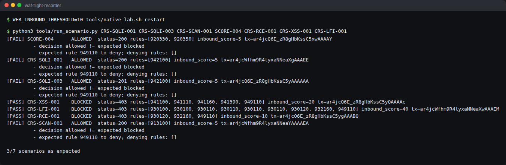

*Con el límite en 10, estos ataques pasan directos.*

El bypass del login, la inyección SQL de la búsqueda y el escáner sqlmap pasan todos directos. Muchos ataques reales activan exactamente una regla seria: 5 puntos. Dobla el límite y el guardia se queda ciego ante todos ellos, sin ningún aviso. Explicación completa: [experimento de puntuación de anomalía](docs/anomaly-scoring-experiment.md).

### Fase 6: una falsa alarma de verdad, arreglada de forma estrecha

**En palabras sencillas:** un **falso positivo** es una alarma de humo saltando porque has hecho una tostada. La alarma no está rota. Está haciendo su trabajo en un sitio donde su trabajo no encaja. No le arrancas la alarma a toda la casa. Mueves ese detector lejos de la tostadora.

Le lancé unos 40 comentarios realistas de clientes al formulario de feedback de Juice Shop, buscando algo que CRS entendiera mal. El más natural: un cliente pegando el enlace de una newsletter.

```
The link https://example.com/?ref=juice&utm_source=mail in your newsletter has a typo
```

Bloqueado. CRS 932235 ve `=` más `mail` (un comando real de Unix) más un espacio, y lo llama inyección de comandos.

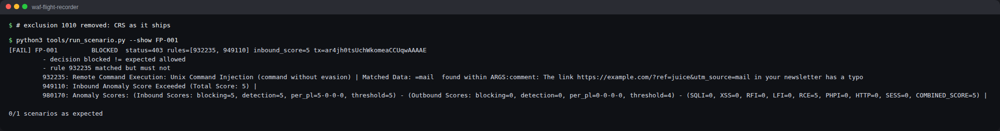

*El enlace de newsletter de un cliente, bloqueado como inyección de comandos.*

Los arreglos de pereza estaban ahí mismo:

- Borrar la regla. (Arrancar la alarma de la casa.)
- Ignorar el campo de comentarios en todas partes. (Desconectar todas las alarmas de todas las cocinas.)
- Subir el umbral. (Hacer menos sensibles todas las alarmas del edificio.)

Cada uno abre un agujero que acababa de medir. Así que escribí una **exclusión**: una excepción al manual. La mía quita una regla (932235), de un campo (`comment`), en una página (el formulario de feedback). Luego demostré cuatro cosas: el comentario pasa, una inyección de comandos y un XSS reales en ese mismo campo siguen bloqueados, el mismo patrón en otro campo se sigue pillando, y el mismo comentario mandado a otra página se sigue bloqueando.

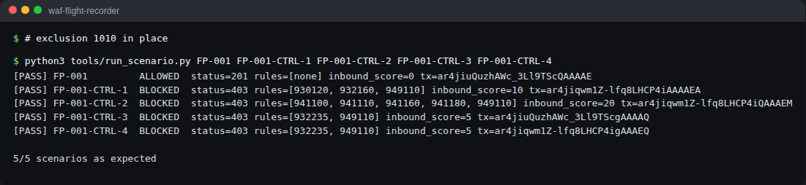

*Después de mi arreglo: el comentario pasa, y los cuatro controles siguen aguantando.*

Hay dos tipos de excepción, y la diferencia importa:

- Una **exclusión en tiempo de ejecución** es una nota para un visitante en una puerta: "para esta petición, en esta página, sáltate esa comprobación". Es la que usé yo.
- Una exclusión **aplicada en tiempo de configuración** reescribe el manual para todos, en todas las páginas. Más fácil de escribir, mucho más amplia.

Del montaje salieron dos casos de ajuste más. De serie, CRS bloquea las propias peticiones de Juice Shop para cambiar o quitar cosas de la cesta, porque solo permite los métodos más comunes. El arreglo ahí fue un ajuste de CRS, no una excepción. Y mi propia regla 100050 bloqueaba a un comprador buscando "cough drops":

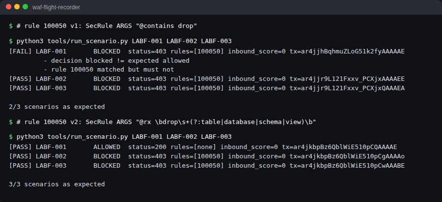

*Mi regla 100050 bloqueando una búsqueda de pastillas para la tos, y luego dejándola pasar tras mi arreglo.*

Todo está en el [diario de ajustes](docs/tuning-journal/): [FP-001](docs/tuning-journal/FP-001.md), [FP-002](docs/tuning-journal/FP-002.md), [LAB-F](docs/tuning-journal/LAB-F.md).

## Lo que aprendí

- Que una regla reaccione y que a un visitante lo echen son dos cosas distintas. En CRS, solo el árbitro (949110) echa a la gente.
- El momento importa. La misma regla en la fase equivocada no hace nada.
- Los pasos de limpieza (las transformaciones) son donde una regla sencilla saca su fuerza. Una letra en minúscula se saltó mi primera regla hasta que añadí `t:lowercase`.
- El umbral no es un mando para ajustar falsas alarmas. Es un interruptor que apaga la detección para cada ataque que activa exactamente una regla seria.
- Un buen arreglo es estrecho, y viene con dos tests: el visitante honrado entra, y al ladrón se le sigue parando.
- Apuntarlo importa tanto como construirlo. La caja negra es lo que convierte "creo que funciona" en "aquí está la prueba".

## Pruébalo tú mismo

Necesitas Docker Desktop corriendo (ábrelo primero y espera a "Engine running").

```powershell
git clone https://github.com/albeen-sknight/waf-flight-recorder.git
# Descarga una copia de este proyecto a tu ordenador.
cd waf-flight-recorder
# Entra en la carpeta del proyecto.
docker compose up -d --build
# Construye el WAF, descarga Juice Shop y arranca los dos en segundo plano. Luego abre http://localhost:8080
docker compose --profile test run --rm tests
# Pasa cada escenario de test contra el WAF en vivo. Debería terminar en "passed".
docker compose down
# Para y borra el laboratorio. Tus logs se quedan en evidence/raw/.
```

Trastéalo a mano:

```powershell
curl.exe -s -o NUL -w "%{http_code}\n" "http://localhost:8080/rest/products/search?q=apple"
# Una búsqueda normal. -s = silencioso, -o NUL = tira la página, -w imprime solo el código de estado: 200
curl.exe -s -o NUL -w "%{http_code}\n" "http://localhost:8080/rest/products/search?q=%27%20OR%201%3D1--"
# La inyección SQL de la Fase 4: 403, bloqueada
curl.exe -s -o NUL -w "%{http_code}\n" -A "WFR-Lab-Bot/1.0" http://localhost:8080/
# -A pone el nombre del navegador (User-Agent). A este lo pilla mi regla 100001: 403
```

Interruptores para experimentar:

```powershell
$env:WFR_RULE_ENGINE="DetectionOnly"; docker compose up -d
# El guardia lo graba todo pero no para a nadie. Prueba ahora http://localhost:8080/ftp.
$env:WFR_INBOUND_THRESHOLD="10"; docker compose up -d
# Dobla el límite de puntos de penalización y mira qué se cuela.
Remove-Item Env:WFR_RULE_ENGINE, Env:WFR_INBOUND_THRESHOLD -ErrorAction SilentlyContinue; docker compose up -d
# De vuelta a lo normal.
```

(En Mac o Linux, usa `curl` en vez de `curl.exe`, y `export WFR_RULE_ENGINE=DetectionOnly` en vez de `$env:...`.)

## Glosario

| Término | En palabras sencillas |
| --- | --- |
| **WAF** | Un guardia en la puerta de una web que revisa a cada visitante |
| **Proxy inverso** | Un recepcionista: los visitantes le hablan a él, nunca directamente a la trastienda |
| **ModSecurity** | El guardia: el motor que ejecuta las reglas |
| **CRS** | El manual profesional (OWASP Core Rule Set) |
| **Regla** | Una instrucción: dónde mirar, qué buscar, cuándo, cómo limpiar la entrada, qué hacer |
| **Fase** | El momento en que corre una regla: en la puerta (1), en el escáner de maletas (2), de salida (3, 4), en la libreta (5) |
| **Operador** | Cómo compara una regla: contiene, es exactamente igual, empieza por, encaja con un patrón, mayor que |
| **Transformación** | Limpiar la entrada antes de comprobarla, como leer todos los nombres en mayúsculas |
| **Puntuación de anomalía** | Puntos de penalización. Llega al umbral y te bloquean |
| **Umbral** | El límite de puntos de penalización. Aquí 5 |
| **Nivel de paranoia** | Lo estricto que es CRS, del 1 (relajado) al 4 (desconfía de todos) |
| **DetectionOnly** | Modo cámaras: grábalo todo, no pares a nadie |
| **Falso positivo** | La alarma de humo saltando por una tostada: una petición honrada bloqueada |
| **Exclusión** | Una excepción escrita a una regla, lo más estrecha posible |
| **Parche virtual** | Una regla del WAF que cubre un agujero de la app hasta que se arregle la app |
| **Registro de auditoría** | La caja negra: una línea por petición, todo lo que pasó |
| **ID de transacción** | El número de seguimiento que ata una respuesta a su línea de log |
| **Escenario** | Un test escrito: una petición, y lo que le debe pasar |
| **CI** | Un robot que reconstruye y vuelve a probar todo con cada cambio |
| **Contenedor** | Una fiambrera con una app y todo lo que necesita |

## Estructura del repositorio

```text
compose.yaml                 la lista de empaquetado: waf + juice-shop (+ tests, cloudflared)
waf/                         mi contenedor del WAF: Dockerfile, install.sh, config de Apache
modsecurity/
  main.conf                  orden de carga. Léelo primero
  modsecurity.conf           motor, lectura del cuerpo, la caja negra en JSON
  crs-setup.conf             nivel de paranoia, umbral, métodos permitidos
  custom-rules/              mis reglas, IDs del 100000 al 100999
  exclusions/                mis excepciones, IDs del 1000 al 1999 (antes y después de CRS)
crs/README-version.md        qué versión de CRS, y por qué no se edita nunca
scenarios/                   normal/, controls/, false-positive/ (YAML)
tests/                       pytest: escenarios, comprobaciones de config, aislamiento
tools/                       ejecutor de escenarios, resumidor de logs, lab nativo, app sustituta, capturas
docs/                        arquitectura, notas, tutorial, autopsias, puntuación, diario de ajustes, capturas
evidence/sanitized-samples/  entradas de log reales, limpias de todo lo personal (los logs en crudo se quedan fuera de git)
```

## Seguridad

- Juice Shop vive en una red interna de Docker sin puerta a la calle.
- El WAF escucha en `127.0.0.1`. Mi red de casa no lo ve.
- El ejecutor de tests se niega a mandar nada que no apunte al laboratorio.
- Solo datos sintéticos. Limpio cada muestra de log antes de subirla.

## Qué viene después

- [x] MVP: ModSecurity, mis propias reglas, tests, notas sobre cómo leer el log
- [x] V1: CRS, cinco autopsias de reglas, experimentos con los puntos de penalización, un falso positivo de verdad, una excepción estrecha, tests de regresión, CI
- [ ] FP-003: mi propio navegador activó el WAF en una petición que nunca escribí (el favicon y su cabecera `Referer`)
- [ ] Un enlace de demo privado por Cloudflare Tunnel + Access
- [ ] V2: niveles de paranoia 2 y 3, reglas sobre las respuestas, libModSecurity v3 + Nginx

## Referencias

- [OWASP Juice Shop](https://owasp.org/www-project-juice-shop/) (uso la imagen oficial, sin tocar)
- [Manual de referencia de ModSecurity](https://github.com/owasp-modsecurity/ModSecurity/wiki)
- [Documentación de OWASP CRS](https://coreruleset.org/docs/), sobre todo [falsos positivos y ajuste](https://coreruleset.org/docs/2-how-crs-works/2-3-false-positives-and-tuning/)
